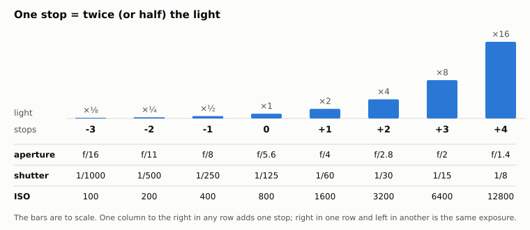
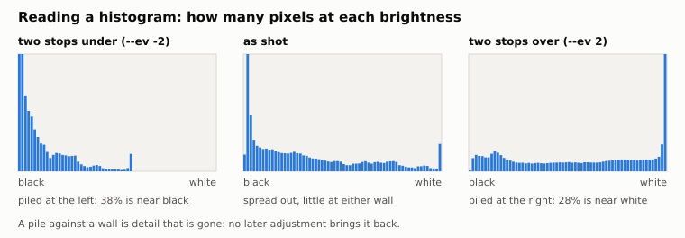
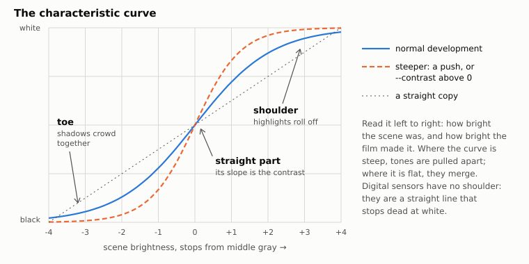
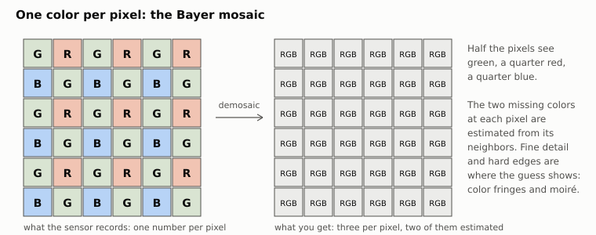
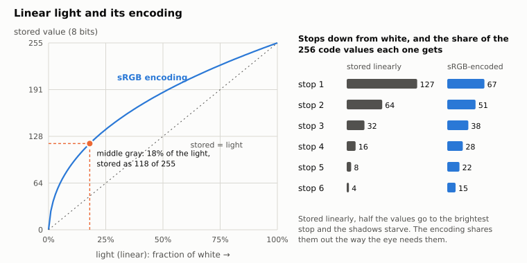
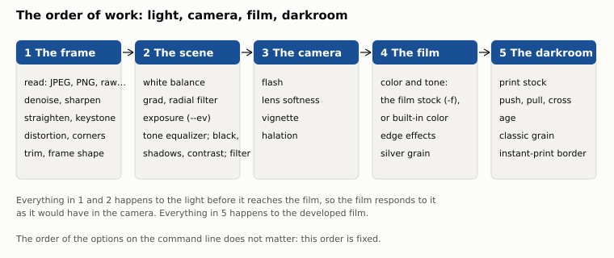
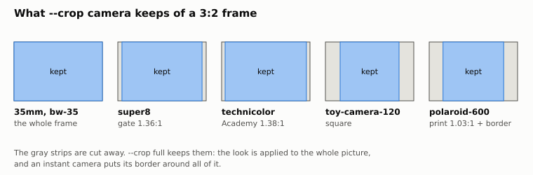
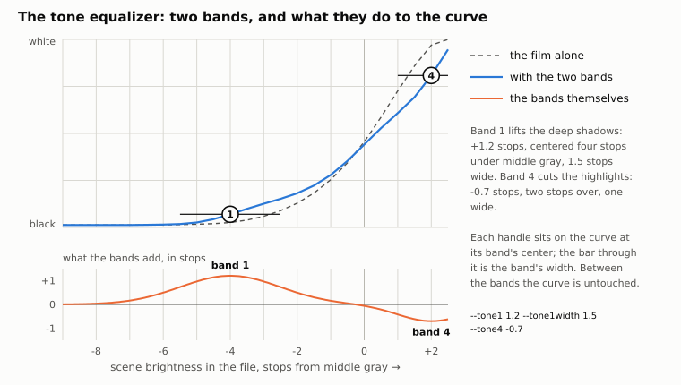
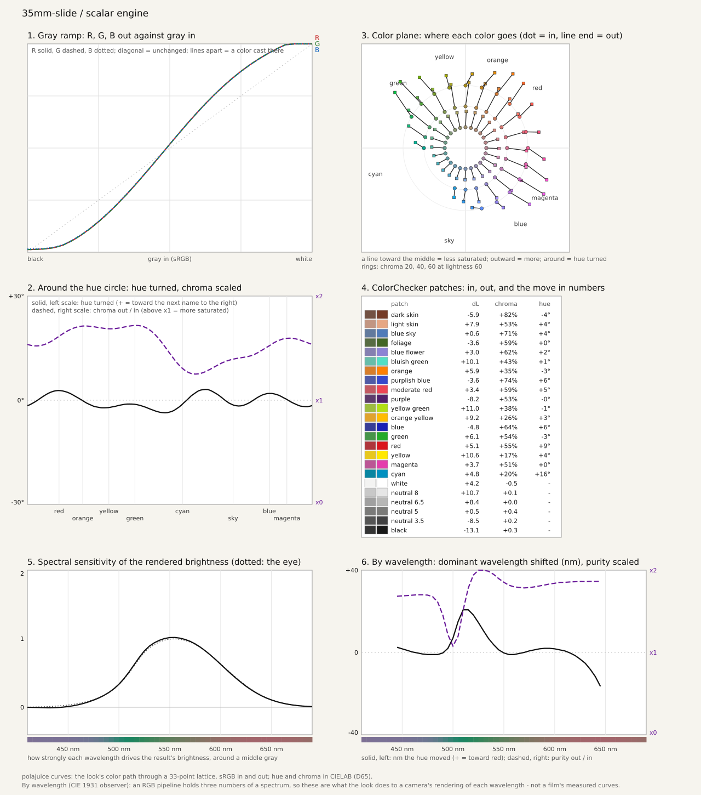

# The polajuice guide

**Photography, digital pictures and film looks: from the first command to the last control.**


Polajuice turns a digital photograph into the picture a film camera would
have made of the same scene: the color of the stock, the grain, the glow
around bright lights, the shape of the frame. This guide teaches the
photography you need to use it well, explains every control, and ends with
advice on style. It assumes nothing: if you have never set an exposure or
opened a terminal, start at the top. If you have done both for decades, the
contents will take you where you want to go.

Written for polajuice 1.35 and later. The photographs are the author's own
(© Mico Mrkaic, CC BY 4.0) and ship with the program.

---

## How to read this guide

There are three ways through it.

- **Ten minutes.** Read [chapter 1](#1-start-in-ten-minutes) and stop. You
  will have installed the program, made four pictures and seen the page
  where everything can be done with sliders.
- **The course.** Read chapters 2 to 5 in order. They explain what
  exposure, tone and color are, what a digital file holds, what the
  storage formats do to it, and how film differs. Each idea comes with a
  picture and the command that made it.
- **The manual.** Chapters 6 and 7 take every command and control one at a
  time. Chapter 8 is about style, chapter 9 is for experts, and the
  appendices hold a table of every option, a glossary and a list of things
  that go wrong.

**About the pictures.** Every picture here was made by the command printed
above it, from six small photographs that come with the program. They were
rendered with no film library installed, so they show each camera's
built-in color. With the library installed (the usual case) your colors
will be those of the camera's real film stock and will differ a little from
the page. Everything else will match. To keep the guide small, the
pictures are small and were saved at a lower JPEG quality than the
program's default.

**About the commands.** Lines in a gray box are typed in a terminal,
exactly as printed. To follow along, copy the six photographs somewhere you
can make a mess. From the source folder:

```sh
cp -r docs/guide/photos juice-play
cd juice-play
```

After `make install` the photographs, and this guide, are also in
`~/.local/share/polajuice/doc/`.

## Contents

1. [Start in ten minutes](#1-start-in-ten-minutes)
2. [How a photograph is made](#2-how-a-photograph-is-made)
3. [The digital photograph](#3-the-digital-photograph)
4. [File formats and keeping pictures](#4-file-formats-and-keeping-pictures)
5. [Film, and what polajuice does](#5-film-and-what-polajuice-does)
6. [The controls, one by one](#6-the-controls-one-by-one)
7. [Working: files, recipes, the page, movies, other programs](#7-working-files-recipes-the-page-movies-other-programs)
8. [Style](#8-style)
9. [Advanced](#9-advanced)

Appendices: [A. Every option](#appendix-a-every-option) ·
[B. Glossary](#appendix-b-glossary) ·
[C. When something goes wrong](#appendix-c-when-something-goes-wrong) ·
[D. Further reading](#appendix-d-further-reading)

# 1. Start in ten minutes

## 1.1 Install

Polajuice is written in C and needs nothing but a C compiler and `make`.
In the source folder:

```sh
make
make install
```

`make` builds the programs. `make install` copies them to `~/.local/bin`,
installs the manual pages, and downloads the film library (the color
tables of real film stocks). Nothing is installed outside your home
folder, and `make uninstall` removes all of it. If the shell then says
`polajuice: command not found`, add `~/.local/bin` to your `PATH`.

No terminal, or just curious? The whole program also runs in a web
browser, with sliders, at <https://micomrkaic.github.io/polajuice/>.
Nothing is uploaded: the pictures stay on your computer.

## 1.2 Your first picture

```sh
polajuice apply cat.jpg -c polaroid-600 -o cat-polaroid.jpg
```

Read it as a sentence: *apply* a look to `cat.jpg`, the camera (`-c`) is a
Polaroid 600, and the output (`-o`) goes to `cat-polaroid.jpg`. The
original file is never changed.

| `cat.jpg`, the original | `cat-polaroid.jpg` |
|:-:|:-:|
|  |  |

Four things happened. The picture was cut to the shape of an instant print
and given its white border. The lens went soft. The colors and the contrast
became those of the instant film. And a little grain appeared. None of
these was asked for separately: they are what that camera does.

## 1.3 Three more cameras

```sh
polajuice apply cat.jpg -c 35mm-negative -o cat-negative.jpg
polajuice apply cat.jpg -c bw-35 -o cat-bw.jpg
polajuice apply cat.jpg -c super8 -o cat-super8.jpg
```

| `-c 35mm-negative` | `-c bw-35` | `-c super8` |
|:-:|:-:|:-:|
|  |  |  |

Color negative film is the gentle all-rounder. Black-and-white film throws
the color away and keeps the light. A Super 8 frame is tiny (about 6 mm
wide), so it is soft, grainy, and has the muted color of a projected home
movie.

## 1.4 The one idea: a camera and a film

A look in polajuice is two choices.

- The **camera** (`-c`) is everything optical and mechanical: the shape of
  the frame, the sharpness of the lens, the grain, the flash, the glow.
- The **film** (`-f`) is the chemistry: which colors the stock favors and
  how it handles bright and dark.

Every camera has a usual film, loaded when you name none. So the commands
above were complete. To see what there is:

```sh
polajuice cameras
polajuice describe bw-35
polajuice films kodak
```

`cameras` lists the fourteen cameras and the film each one loads.
`describe` tells you about one. `films kodak` lists every stock in the
library with "kodak" in its name. To load a different film, name it, or
part of its name:

```sh
polajuice apply cat.jpg -c 35mm-negative -f kodak_portra_160 -o cat-portra160.jpg
```

Polajuice knows which film fits which camera, and says so when they do not
match: slide film will not go in a Polaroid.

## 1.5 The same thing with sliders

```sh
polajuice serve .
```

Then open <http://localhost:8000> in a browser. The page shows the pictures
in the current folder, every control in this guide as a slider or a menu,
and the result as you move them. It also shows, at all times, the command
that would make the picture on screen, so the page is the easiest way to
learn the commands. Press Ctrl-C in the terminal to stop it.

## 1.6 Where next

You can already make pictures. The rest of the guide is about making the
one you meant. If words like *stop*, *highlight* and *white balance* are
familiar, go to [chapter 5](#5-film-and-what-polajuice-does). If not, the
next chapter is for you, and it is shorter than it looks.

# 2. How a photograph is made

A camera is a dark box with a hole in it. Light from the scene comes
through the hole and lands on something that records how much arrived at
each point: film, or a sensor. Everything else in photography is a
consequence of three questions. How much light? Which tones go where? What
color is white?

## 2.1 The stop

Photographers measure light by doubling. **One stop more** is twice the
light. **One stop less** is half. Two stops more is four times, three is
eight. Nobody says "37% brighter": the eye judges brightness by ratios,
so a scale of doublings is the one on which equal steps look equal.



Every exposure control on every camera is marked in stops, and so are most
of the controls in polajuice. When this guide says `--ev 1`, it means one
stop more light.

> **For the physicist.** A stop is a factor of two in exposure
> (illuminance × time, lux-seconds), so *n* stops is 2ⁿ. Density on film
> and the response of the eye are both roughly logarithmic in exposure,
> which is why the unit is. The f-numbers go in steps of √2 because the
> light admitted goes with the area of the opening.

## 2.2 Exposure: three ways to get one stop

The amount of light recorded is set by three things.

| Setting | What it is | One stop more | What it costs |
|---|---|---|---|
| **Aperture** | the size of the hole, written f/2.8, f/4, f/5.6… | the next *smaller* number | less of the scene is in focus (shallower depth of field) |
| **Shutter speed** | how long the hole is open | twice the time | anything that moves, including your hands, blurs |
| **ISO** | how much the signal is amplified (digital), or how sensitive the film is | twice the number | more noise (digital) or grain (film) |

f/8 at 1/125 s is the same exposure as f/5.6 at 1/250 s: one stop more
through the hole, one stop less in time. The pictures are equally bright
but not the same picture, because the costs are different. Choosing among
equal exposures is most of what a photographer does with the dials:

- A wide aperture (f/1.4 to f/2.8) isolates a face against a blurred room.
  A narrow one (f/8 to f/16) keeps a landscape sharp from the grass to the
  hills.
- A short time (1/500 s and less) freezes a running child. A long one
  (1/15 s and more) turns a waterfall to silk, and needs a tripod.
- A low ISO gives the cleanest picture. Raise it only when the other two
  have nothing left to give.

Once the picture is taken, aperture and shutter are fixed: no program can
change what was in focus or what moved. What a program can change is the
*brightness*, after the fact, and that is what `--ev` does:

```sh
polajuice apply street.jpg -c 35mm-slide --ev -1 -o street-under.jpg
polajuice apply street.jpg -c 35mm-slide -o street-slide.jpg
polajuice apply street.jpg -c 35mm-slide --ev 1 -o street-over.jpg
```

| `--ev -1`: one stop under | no `--ev` | `--ev 1`: one stop over |
|:-:|:-:|:-:|
|  |  |  |

Look at what went wrong at each end. One stop under, the shaded street has
sunk into black. One stop over, the sky and the sunlit wall have gone
white. The middle is not "correct"; it is the exposure that loses least of
what matters in this scene.

## 2.3 The range of a scene, and the histogram

A sunlit street can span twelve stops or more from the deepest shadow to
the brightest cloud. A print on paper shows about six or seven. A good
sensor records twelve to fourteen, slide film about six, negative film ten
or more. Something always has to give, and exposure decides what: move it
up and the highlights fall off the top, move it down and the shadows fall
off the bottom.

The tool for seeing this is the **histogram**: a bar chart of how many
pixels there are at each brightness, black at the left and white at the
right.



There is no ideal shape. A night scene belongs at the left and a snowfield
at the right. What the histogram tells you is whether tones are *piled
against a wall*. Those are clipped: every pixel in the pile has the same
value, the detail that distinguished them is gone, and no later adjustment
recovers it.

Two rules follow, and they are the two most useful sentences in the
chapter.

- **Digital: protect the highlights.** A sensor has no mercy at the top:
  one photon past full and the pixel is plain white. Shadows, in
  contrast, can be lifted a long way. When in doubt, expose a little
  under.
- **Negative film: protect the shadows.** Negative film is the reverse.
  It holds bright tones far past the point where digital clips, and has
  nothing at all in a shadow that got no light. When in doubt, expose a
  little over.

The page shows a histogram of the picture on screen, and a *clipping*
button paints the clipped pixels onto it.

## 2.4 Tone: the curve

Exposure decides how much light. **Tone** is the next question: given the
light, how bright does each part of the picture come out? The answer is a
curve, and every film and every camera has one.



Three things on this curve have names you will meet again.

- **Contrast** is the slope of the straight part. Steep: tones are pulled
  apart, the picture has punch, and less of the scene's range fits. Shallow:
  the picture is flat and gentle, and more fits.
- The **shoulder** is the curve bending over at the top. It is why film
  highlights fade to white gradually instead of hitting a wall.
- The **toe** is the same at the bottom, for shadows.

```sh
polajuice apply car.jpg -c 35mm-negative --contrast -0.6 -o car-flat.jpg
polajuice apply car.jpg -c 35mm-negative -o car-negative.jpg
polajuice apply car.jpg -c 35mm-negative --contrast 0.6 -o car-hard.jpg
```

| `--contrast -0.6` | no `--contrast` | `--contrast 0.6` |
|:-:|:-:|:-:|
|  |  |  |

Middle gray stays where it was in all three: contrast turns the curve
about its middle. Low contrast shows more inside the dark showroom and
looks dull. High contrast makes the chrome shine and loses the shadows.

## 2.5 Color and white balance

The eye has three kinds of color receptor, so three numbers are enough to
describe a color to it: an amount each of red, green and blue. Sensors and
color films record those three.

Light itself has a color. Candlelight and tungsten bulbs are orange,
noon sun is nearly neutral, open shade under a blue sky is blue. Your
visual system corrects for this without telling you: a sheet of paper
looks white in all three. A camera does not, and has to be told what white
is. That setting is the **white balance**, and getting it wrong gives a
picture that is orange or blue all over.

```sh
polajuice apply can.jpg -c 35mm-negative --temp -0.6 -o can-cool.jpg
polajuice apply can.jpg -c 35mm-negative -o can-negative.jpg
polajuice apply can.jpg -c 35mm-negative --temp 0.6 -o can-warm.jpg
```

| `--temp -0.6`: cooler | no `--temp` | `--temp 0.6`: warmer |
|:-:|:-:|:-:|
|  |  |  |

If you would sooner think in the three colors themselves, `--red`,
`--green` and `--blue` do the same job by another route
([section 6.7](#67-white-balance---temp-and---tint)).

Two controls cover it. `--temp` moves between blue and orange, the
direction along which daylight and lamps differ. `--tint` moves between
green and magenta, which is where fluorescent tubes and some LEDs go wrong.

White balance is also a matter of taste. Slightly warm reads as evening,
comfort, memory. Slightly cool reads as morning, distance, quiet. A
"correct" balance that makes candlelight white has usually removed the
reason for the picture.

> **If you do not trust your color vision.** About one man in twelve does
> not see red and green as most people do, and the author of this program
> is one of them. White balance can be set without judging color: find
> something in the picture that should be neutral (paper, a white wall,
> gray pavement) and adjust until its red, green and blue values are
> equal. [Section 8.8](#88-working-by-numbers) lists more checks of this
> kind.

## 2.6 The lens

A lens has one number that matters most: its **focal length**. Short
(24 mm) takes in a wide view, long (200 mm) a narrow one. A phone's main
camera is the equivalent of about 26 mm, and the "normal" view that looks
neither wide nor compressed is about 50 mm.

Perspective comes from where you stand, not from the lens. Stand close
with a wide lens and near things loom large: noses grow, rooms stretch.
Stand back with a long lens and the scene flattens, distant hills stacking
up behind the subject. For a portrait, step back.

Real lenses have faults, and a few of them can be corrected afterwards.

| Fault | What you see | The cure |
|---|---|---|
| **Distortion** | straight lines near the edge bow outward (barrel) or inward (pincushion) | `--distortion` |
| **Vignetting** | the corners are darker than the center | `--devignette` |
| **Converging verticals** | a building photographed from the street leans backward | `--keystonev` |
| **A tilted horizon** | the sea runs downhill | `--rotate` |

Old cameras had these faults in abundance, and they are part of the look:
polajuice's toy camera *adds* a heavy vignette and blurred corners. Correct
the faults of your own lens first, then let the chosen camera put its own
in.

# 3. The digital photograph

## 3.1 A sensor counts light

A sensor is a grid of several million light-sensitive wells, one per
pixel. During the exposure each well collects light and builds up charge;
afterwards the camera reads every well as a number. Three properties of
that number explain most of digital photography.

- **It is proportional.** Twice the light gives twice the number. Film
  bends at both ends (the toe and shoulder of chapter 2); a sensor is a
  straight line.
- **It has a ceiling.** A full well cannot hold more. Everything brighter
  reads as the same maximum: *clipped*, pure white, with no shoulder to
  soften the blow.
- **It is noisy at the bottom.** Light arrives in random packets, so a
  well that caught little is uncertain about how much it caught. Shadows
  are noisy and highlights are clean.

ISO on a digital camera does not make the sensor more sensitive. It turns
up the amplification of what was caught. A high-ISO picture is noisy
because it was made from little light, not because of the dial.

> **For the physicist.** Photon arrival is a Poisson process, so a pixel
> that collects *N* photoelectrons has shot noise √*N* and a
> signal-to-noise ratio of √*N*. A full well of 40,000 electrons gives
> 200:1; ten stops down there are 40 electrons and 6:1, before the read
> noise of the electronics is added. That is the whole reason for
> "protect the highlights, then lift the shadows as far as the noise
> allows", and for the cleaner pictures of larger sensors: more area,
> more photons.

## 3.2 One color per pixel

A well measures how much light, not what color. To see color, the sensor
has a mosaic of tiny filters over it, so each pixel records only red, only
green or only blue.



The camera, or the program that opens the raw file, fills in the two
missing colors at every pixel from its neighbors. This step is called
**demosaicing**, and it is an estimate. Where it guesses wrong you see
colored fringes on sharp edges and false patterns (moiré) in fine cloth.
Polajuice uses a simple demosaic; the softness of the lenses it emulates
and the grain it adds cover what a sharper one would have gained.

## 3.3 From sensor numbers to a picture

Between the sensor and a picture you can look at, six things are done.

1. **Black level.** Subtract the small reading a well gives in total
   darkness.
2. **White balance.** Multiply red and blue so that neutral things come
   out neutral ([section 2.5](#25-color-and-white-balance)).
3. **Demosaic.** Fill in the missing colors.
4. **Color conversion.** Translate the sensor's own red, green and blue
   into standard ones, so the same numbers mean the same color on every
   screen.
5. **Tone curve.** Bend the straight line: add contrast, give the
   highlights a shoulder.
6. **Encoding.** Store the result compactly, usually as 8 bits per color.

When you shoot JPEG, the camera does all six, by its maker's taste, and
throws the sensor numbers away. When you shoot **raw**, the camera saves
the numbers after step 0 and every decision is still open. *Developing* a
raw file means doing these six steps yourself.

## 3.4 Linear light and encoded values

Sensor numbers are **linear**: proportional to light. The values in a JPEG
are not. They are **encoded**, bent by a curve (commonly called gamma)
that spends more of the available numbers on dark tones.



The reason is economy. The eye can tell 1% of white from 2% far more
easily than 98% from 99%, so an 8-bit file with only 256 levels has to
place them where the eye is looking. This has two consequences worth
remembering.

- **Middle gray is not half.** A gray card that reflects 18% of the light
  is stored as about 118 out of 255. Half the stored scale is not half
  the light.
- **Light adds up only in linear.** Blurring, mixing, exposure changes
  and the glow around a lamp are physical processes on light. Done on
  encoded values they come out wrong (dark fringes, muddy blends).
  Polajuice decodes every input to linear light, does all its work there,
  and encodes once at the end.

## 3.5 Bits and headroom

| | Levels per color | Scale | Above white |
|---|---|---|---|
| JPEG, 8-bit | 256 | encoded | nothing: white is the top |
| Raw, 12-bit | 4,096 | linear | whatever the tone curve had not used yet |
| Raw, 14-bit | 16,384 | linear | the same, with finer shadows |

The last column is the important one. A camera's JPEG tone curve places
"white" well below the point where the sensor clips, and rolls the
highlights off above it. In the JPEG, everything in that roll-off has been
squeezed into the last few values. In the raw file it is still spread out
over a stop or more. That is why a sky that is blank white in the JPEG can
often be brought back from the raw file, and why polajuice's glow and
highlight controls do more on raw input: there is something up there for
them to work with.

Eight bits are enough to *look at*. They are not enough to *work on*
heavily: brighten an 8-bit shadow by three stops and its few distinct
levels spread into visible bands. Edits belong on the raw file, or as
close to it as you have.

## 3.6 Raw or JPEG?

| | JPEG from the camera | Raw |
|---|---|---|
| Ready to use | yes | no: must be developed |
| File size | small | three to six times larger |
| White balance | baked in | free choice afterwards |
| Blown highlights | gone | about a stop recoverable |
| Shadows | lift a little | lift a lot |
| The camera maker's look | baked in | absent: you start from neutral |

If the picture matters and you will work on it, shoot raw. If it is one of
two hundred from a birthday party, JPEG is fine. Polajuice takes both, and
a phone JPEG through a film look is a perfectly good photograph.

With a raw file, start by looking at what is in it:

```sh
polajuice inspect DSC_0412.NEF
polajuice develop DSC_0412.NEF -o straight.jpg
```

`inspect` reports the camera, the bit depth, the lens, the average level in
stops below the sensor's white, and the share of pixels that clipped.
`develop` makes the *straight print*: the six steps above and nothing
else, no camera and no film. It is the honest starting point to compare a
look against.

# 4. File formats and keeping pictures

## 4.1 The formats at a glance

| Format | Kind | Bits per color | Good for | polajuice |
|---|---|---|---|---|
| **JPEG** `.jpg` | lossy | 8 | sharing, the web, final copies | reads and writes |
| **PNG** `.png` | lossless | 8 or 16 | graphics, screenshots, exact copies | reads; writes 8-bit |
| **TIFF** `.tif` | lossless (usually) | 8 or 16 | exchange between editing programs, archives | reads 16-bit linear with `--linear` |
| **HEIC** `.heic` | lossy | 8 or 10 | what phones save by default | reads through a converter |
| **Raw** `.nef` `.dng` `.cr3` `.arw`… | sensor data | 12 to 14 | the original, kept forever | reads `.nef` and `.dng` |
| **PPM** `.ppm` | uncompressed | 8 | passing pictures between programs | reads and writes |
| **WebP, AVIF** | lossy or lossless | 8 to 12 | the web | not read |

*Lossy* means the file is smaller because detail the eye is unlikely to
miss has been thrown away for good. *Lossless* means the file unpacks to
exactly the picture that went in.

## 4.2 JPEG, and what quality means

JPEG is the format most photographs live in. It compresses in three
steps, each exploiting a weakness of the eye.

1. The picture is split into brightness and color, and the color is
   usually stored at half resolution: we see fine detail in brightness,
   not in color.
2. Each 8 × 8 block of pixels is rewritten as a sum of patterns, from
   smooth to finely checkered.
3. The amounts of the fine patterns are rounded off coarsely, often to
   zero. Long runs of zeros compress to almost nothing.

The **quality** setting, 1 to 100, is how coarse the rounding in step 3
is. It is not a percentage of anything.

```sh
polajuice apply tower.jpg -c 35mm-slide --quality 92 -o tower-q92.jpg
polajuice apply tower.jpg -c 35mm-slide --quality 8 -o tower-q8.jpg
```

| `--quality 92` (the default): 88 kB | `--quality 8`: 14 kB |
|:-:|:-:|
|  |  |

At quality 8 the method shows through: the sky breaks into 8 × 8 blocks,
edges grow halos, and color smears across them. What to use:

| Quality | Use |
|---|---|
| 92 (polajuice's default) to 95 | final copies you may want to print or edit again |
| 80 to 90 | the web, e-mail, messaging: half the size, hard to tell apart |
| below 70 | only when size is everything |
| 100 | never: twice the size of 95 for nothing visible |

**Every save loses a little more.** Opening a JPEG and saving it again
rounds off numbers that were already rounded. Edit from the original, save
the result once, and never use a JPEG as the working copy of something you
are still changing. Polajuice follows that rule for you: it always reads
the original and writes a new file.

## 4.3 PNG, TIFF and PPM

**PNG** is lossless, so it is exact, and for photographs it is large: the
tower above is 468 kB as PNG against 88 kB as a JPEG you could not tell
from it. Use PNG when the next program must receive exactly these pixels,
or when you will measure them.

**TIFF** is a container that can hold almost anything; in practice it
carries 16-bit pictures between editing programs. Polajuice accepts one
kind: 16-bit, uncompressed, scene-linear, read with `--linear`. That is
what `dcraw -4 -T` and darktable's linear export write, and it is the way
in for raw formats polajuice does not read itself (see
[section 7.7](#77-raw-files)).

**PPM** is the simplest format there is: a three-line header and the raw
numbers. Nothing is smaller to write a program for, so it is the format
for piping pictures between tools.

The output format follows the name you give with `-o`:

```sh
polajuice apply tower.jpg -c bw-35 -o tower-exact.png
polajuice apply tower.jpg -c bw-35 -o tower-plain.ppm
```

## 4.4 HEIC, the phone format

iPhones, and many Android phones, save HEIC by default: about half the
size of a JPEG at the same quality. It is built on a video codec that is
complicated and patented, so polajuice does not decode it itself. Three
ways in:

- Install a converter once (`libheif-examples` on Debian and Ubuntu,
  `libheif-tools` on Fedora, `libheif` from Homebrew, or ImageMagick; on
  a Mac, `sips` is already there). Polajuice then converts each HEIC on
  the way in and leaves a `NAME_from_heic.jpg` beside it.
- Set the phone to save JPEG: on an iPhone, Settings → Camera → Formats →
  *Most Compatible*.
- Shoot ProRAW on a recent iPhone. That is a DNG, which polajuice reads
  directly, and it is the best of the three.

## 4.5 Raw formats

Every camera maker has its own raw format: NEF (Nikon), CR3 (Canon), ARW
(Sony), RAF (Fuji), ORF (Olympus and OM System). **DNG** is Adobe's open
one, written directly by some cameras and phones, and any other raw file
can be converted to it with Adobe's free DNG Converter.

Polajuice reads NEF and DNG. For anything else, convert to DNG first, or
export a 16-bit linear TIFF or PNG from another raw developer and read it
with `--linear`.

A raw file is not a picture. It has no white balance applied, no
contrast, and it looks flat and dark when opened with no processing.
That is not a fault: it is the negative, and the print is still to be
made.

## 4.6 What else is in the file

A photograph file carries notes about itself, called **EXIF**: the time,
the camera and lens, the exposure, and on a phone usually the place, to
within a few meters. Check what you are about to publish.

Polajuice's output carries none of that: no camera data and no location.
It carries one thing of its own, the **recipe**: the complete list of
settings that made the picture, stored as a comment in every JPEG it
writes.

```sh
polajuice inspect cat-polaroid.jpg
```

That prints the size of the picture and its recipe. Any polajuice JPEG can
therefore be used to make another picture look the same way
([section 7.2](#72-recipes)): the look travels with the photograph.

## 4.7 Looks as files: the LUT

A **LUT** (lookup table) is a color transform stored as a table: for each
input color, the output color. A `.cube` file is the common text format
for one. It can hold what no set of sliders can: the exact, uneven way a
particular film stock renders every hue at every brightness. The films in
polajuice's library are `.cube` files measured from real film, and any
`.cube` you have from elsewhere can be loaded as a film:

```sh
polajuice apply cat.jpg -c 35mm-negative -f my-look.cube -o cat-mylook.jpg
```

A LUT knows only about color. It cannot add grain, blur or a border, and
it knows nothing about the pixel next door. That is the division of labor
in polajuice: the film is a LUT, the camera is everything a LUT cannot be.

## 4.8 Keeping pictures

A few habits save most of the grief.

- **Never edit the original.** Keep what came out of the camera as it is,
  read-only if you can. Every program worth using, this one included,
  writes its results to new files.
- **Keep the recipe, not just the result.** A result can be remade from
  the original and its recipe at any size, with any later improvement of
  the program. Polajuice JPEGs carry theirs; `--save-recipe` writes it as
  a small text file.
- **Three copies, two kinds of storage, one elsewhere.** A disk in the
  computer, an external disk, and a copy in another building or in the
  cloud. A photograph that exists once will eventually not exist.
- **Name folders by date.** `2026/2026-11-20 beach/` sorts itself forever.
- **Export for the destination.** For screens, 2,000 pixels on the long
  side at quality 85 is plenty. For a print, allow 300 pixels per inch:
  a 20 × 30 cm print wants about 2,400 × 3,600. Polajuice does not
  resize: it renders at the size of its input, so shrink before or after
  with another tool.

# 5. Film, and what polajuice does

## 5.1 Film in one page

Film is a strip of plastic coated with gelatin that holds billions of
silver salt crystals. Light changes the crystals it strikes; development
turns the changed ones into specks of metallic silver, which are black.
That is the whole of black-and-white photography, and the origin of most
things people love about film.

- **Grain** is those specks, clumped at random. Sensitive (fast) films
  need bigger crystals, so they are grainier. Grain is in the picture's
  structure, not laid on top, and it is most visible in the middle tones.
- **The curve.** Film answers light with the S-shaped curve of
  [section 2.4](#24-tone-the-curve). Highlights compress gradually
  instead of clipping.
- **Halation.** Bright light passes through the coating, bounces off the
  back of the film and exposes it again from behind, a little way off.
  Lamps and chrome get a soft glow, red-orange on color film because the
  red-sensitive layer lies deepest.

**Color film** stacks three such layers, sensitive to blue, green and
red, each forming a dye instead of leaving silver. The particular dyes,
and the way the layers influence each other, give every stock its palette.
Four families matter here.

| Family | What it is | Character |
|---|---|---|
| **Color negative** (process C-41) | records tones reversed, on an orange base; printed or scanned to a positive | forgiving, wide range, gentle highlights, soft color |
| **Slide**, or reversal (E-6; Kodachrome's K-14) | the film itself is the finished picture | high contrast, saturated, narrow range: the exposure must be right |
| **Black-and-white** | silver only | tone and grain, no color to distract |
| **Instant** | develops itself in the hand | soft, low contrast, with a palette of its own and the famous border |

Two darkroom moves complete the vocabulary. **Pushing** is exposing a
film less than its rating and developing longer to make up: contrast
and grain go up. **Cross-processing** is developing slide film in negative
chemistry: the colors shift wildly and contrast soars.

## 5.2 The order of work

Polajuice does things in the order they would have happened to the light.



This order is why the controls behave as they do. Because exposure comes
before the film, `--ev 1` does not simply brighten the picture: it moves
every tone up the film's curve, so highlights compress into the shoulder,
colors shift as they would on that stock, and more of the scene is bright
enough to glow. And because grain comes after, it is not blurred by the
lens.

You never need to think about the order of the options on the command
line. It makes no difference: the pipeline's order is fixed.

## 5.3 The cameras

Seven of the fourteen cameras take film in rolls.

```sh
polajuice apply car.jpg -c 35mm-negative -o car-negative.jpg
polajuice apply car.jpg -c 35mm-slide -o car-slide.jpg
polajuice apply car.jpg -c bw-35 -o car-bw.jpg
polajuice apply car.jpg -c midcentury-rangefinder -o car-rangefinder.jpg
polajuice apply car.jpg -c disposable-flash -o car-disposable.jpg
polajuice apply car.jpg -c cinestill-night -o car-cinestill.jpg
polajuice apply car.jpg -c toy-camera-120 -o car-toy.jpg
```

| `35mm-negative` | `35mm-slide` | `bw-35` |
|:-:|:-:|:-:|
|  |  |  |
| clean, fine grain, gentle highlights | more contrast, richer color, hard highlights | ISO 400 black-and-white: honest grain |

| `midcentury-rangefinder` | `disposable-flash` | `cinestill-night` |
|:-:|:-:|:-:|
|  |  |  |
| a late-1940s folding camera: an uncoated lens that flares | ISO 800, a plastic lens and a flash that lights what is near and loses the rest | cine film with its anti-halation layer removed: red glow around every light |

| `toy-camera-120` | |
|:-:|:-:|
|  | |
| a square plastic camera: dark blurred corners | |

Three are instant cameras. They add the print's border, and development
controls do not apply to them: an instant picture develops itself.

```sh
polajuice apply cat.jpg -c polaroid-sx70 -o cat-sx70.jpg
polajuice apply cat.jpg -c polaroid-packfilm -o cat-packfilm.jpg
```

| `polaroid-600` | `polaroid-sx70` | `polaroid-packfilm` |
|:-:|:-:|:-:|
|  |  |  |
| the 1980s family print: soft, nearly grainless | the 1970s original: dreamier and warmer | peel-apart film in a Land camera: crisper, thin even border |

One is a movie camera, `super8`, shown in chapter 1. And three are
*sealed processes*: historical ways of making color in which the process
is the medium, so they take no film at all.

```sh
polajuice apply beach.jpg -c technicolor-3strip -o beach-technicolor.jpg
polajuice apply beach.jpg -c autochrome -o beach-autochrome.jpg
polajuice apply beach.jpg -c polavision -o beach-polavision.jpg
```

| `technicolor-3strip` | `autochrome` | `polavision` |
|:-:|:-:|:-:|
|  |  |  |
| 1930s to 1950s cinema: three black-and-white negatives printed in dye. Saturated and smooth | the first color plates, 1907: dyed starch grains. Pastel, speckled, slightly faded | Polaroid's instant home movie of 1977: dim and stippled |

Every camera with a frame shape of its own cuts that shape from the
middle of your picture. [Section 6.11](#611-framing-crop-and-trim) shows
how to keep the whole frame instead.

## 5.4 The films

The camera's usual film is right most of the time. To choose another,
list what fits and name it:

```sh
polajuice films portra
polajuice apply cat.jpg -c 35mm-negative -f kodak_portra_800 -o cat-portra800.jpg
polajuice apply cat.jpg -c bw-35 -f tri-x -o cat-trix.jpg
```

Any distinctive part of the name will do. If it matches several stocks,
polajuice lists them and asks you to be more exact.

Which camera takes what:

| Camera | Takes |
|---|---|
| `35mm-negative`, `cinestill-night` | color negative |
| `35mm-slide`, `super8` | slide |
| `bw-35` | black-and-white |
| `disposable-flash` | color negative, black-and-white |
| `midcentury-rangefinder`, `toy-camera-120` | slide, color negative, black-and-white |
| `polaroid-600`, `polaroid-sx70` | Polaroid integral film |
| `polaroid-packfilm` | peel-apart pack film |
| `technicolor-3strip`, `autochrome`, `polavision` | nothing: sealed |

Three options bend these rules.

- `--any-film` loads a film the camera would not take. Wrong film in the
  wrong camera is a tradition of its own.
- `--no-film` uses the camera's built-in color instead of a film. It is
  simpler and less particular than a real stock: useful when you want the
  camera's optics and grain with unremarkable color.
- `-f FILE.cube` loads any LUT file as the film
  ([section 4.7](#47-looks-as-files-the-lut)).

A few words on choosing, for those who have not shot these stocks. Among
color negatives, the Kodak Portra family is soft and kind to skin; the
number is the speed, and higher means grainier. Among slides, Fuji Velvia
is the saturated landscape film, Provia the neutral one, and Kodachrome
the look of mid-century magazines: deep reds, firm contrast. In
black-and-white, Kodak Tri-X and Ilford HP5 are the gritty classics, and
the T-Max and Delta films are smoother. The fastest way to choose is to
see them all at once: the page has a *contact sheet* that renders your
picture through every film the camera takes
([section 7.4](#74-the-workspace-page)).

## 5.5 Print stocks

A negative is not the end of the road. It was printed onto paper, or onto
print film for the cinema, and that material had a curve and a palette of
its own. `--print` adds that second step. Three print stocks ship with the
program.

```sh
polajuice apply beach.jpg -c 35mm-negative -o beach-negative.jpg
polajuice apply beach.jpg -c 35mm-negative --print synthetic_minilab -o beach-minilab.jpg
polajuice apply beach.jpg -c 35mm-negative --print synthetic_cine_print -o beach-cine.jpg
```

| no print stock | `--print synthetic_minilab` | `--print synthetic_cine_print` |
|:-:|:-:|:-:|
|  |  |  |
| | the one-hour photo lab: more contrast, stronger color | a projection print: darker, with deeper blacks |

The third, `synthetic_archival_neutral`, is a gentle neutral print. Any
`.cube` file can be given to `--print` as well.

## 5.6 How much: strength

`--strength` blends between your picture (0) and the full look (1). It
scales the camera, the film and the grain together.

```sh
polajuice apply car.jpg -c toy-camera-120 --crop full --strength 0.4 -o car-toy-40.jpg
polajuice apply car.jpg -c toy-camera-120 --crop full -o car-toy-full.jpg
```

| `--strength 0.4` | full strength |
|:-:|:-:|
|  |  |

A look at 0.6 or 0.7 often serves a picture better than the whole thing:
the viewer senses film without being shown an effect. Strength does not
touch the corrections you make yourself (`--ev`, `--temp` and the rest of
[chapter 6](#6-the-controls-one-by-one)); those always apply in full.

# 6. The controls, one by one

Each section says what the control is in photography, what it does here,
its range, and when to reach for it. Unless stated otherwise, 0 means
"leave it alone", and every control can be combined with every other.
[Appendix A](#appendix-a-every-option) has them all in one table.

## 6.1 Exposure: `--ev`

**What it is.** The amount of light, in stops
([section 2.1](#21-the-stop)). Range −4 to +4.

**What it does.** `--ev 1` doubles the light reaching the film; `--ev -1`
halves it. Because it acts before the film, it is not a plain brightness
slider. Tones travel along the film's curve: raise the exposure and the
highlights compress into the shoulder, colors shift as they would on that
stock, and more of the picture becomes bright enough to glow. The three
street pictures in [section 2.2](#22-exposure-three-ways-to-get-one-stop)
show it.

**When.** First, before anything else. Get the brightness of the main
subject right and judge every other control after that. Half a stop is a
clear change; a tenth is the smallest worth typing.

## 6.2 Development: `--develop`

**What it is.** How the film was processed. Three kinds of value.

| Value | Meaning | Effect |
|---|---|---|
| `normal` | by the book | the default |
| `push+1`, `push+2`… up to `push+4` | shot that many stops under, developed longer to make up | more contrast, more saturation, more grain |
| `pull-1`… down to `pull-3` | shot over, developed shorter | less contrast, softer color, finer grain |
| `cross`, `cross+1`… | slide film in negative chemistry, optionally pushed too | shifted color, high contrast |

Halves are allowed (`push+1.5`).

```sh
polajuice apply can.jpg -c 35mm-negative --develop pull-1 -o can-pull.jpg
polajuice apply can.jpg -c 35mm-negative --develop push+2 -o can-push.jpg
```

| `--develop pull-1` | normal | `--develop push+2` |
|:-:|:-:|:-:|
|  |  |  |

**The brightness comes out even.** A push is the *whole* operation: less
light in the camera and longer in the developer. The two cancel in
brightness, and what is left is the character. So a push needs no `--ev`
to go with it; adding `--ev -2` to `push+2` would count the underexposure
twice and give a dark picture.

```sh
polajuice apply can.jpg -c 35mm-slide -o can-slide.jpg
polajuice apply can.jpg -c 35mm-slide --develop cross -o can-cross.jpg
```

| slide film, normal | `--develop cross` |
|:-:|:-:|
|  |  |

**When.** Push for grit: street scenes, concerts, bad weather. Pull for
harsh midday light you want to calm. Cross-process when the color is the
subject. Instant cameras ignore `--develop`, and a black-and-white camera
ignores `cross`: there is no color to shift.

## 6.3 Grain: `--grain`, `--grainamount`, `--grainsize`, `--seed`

**What it is.** The texture of the film's silver
([section 5.1](#51-film-in-one-page)). Four controls.

| Control | Range | Meaning |
|---|---|---|
| `--grainamount` | 0 to 4 | how much: 0 none, 1 the camera's own, 2 double |
| `--grainsize` | 0.5 to 4 | how coarse: 1 the camera's own, 2 twice the size at the same strength |
| `--grain` | `classic` or `silver` | the model: laid over the picture, or formed inside it |
| `--seed` | any whole number | which random pattern |

```sh
polajuice apply cat.jpg -c bw-35 --grainamount 0 -o cat-bw-clean.jpg
polajuice apply cat.jpg -c bw-35 --grainamount 3 -o cat-bw-gritty.jpg
polajuice apply cat.jpg -c bw-35 --grainsize 3 -o cat-bw-coarse.jpg
```

| `--grainamount 0` | `--grainamount 3` | `--grainsize 3` |
|:-:|:-:|:-:|
|  |  |  |

Amount and size are independent: changing the size keeps the strength the
same and only makes the clumps bigger. The camera's own grain is the
picture in [section 1.3](#13-three-more-cameras).

`--grain silver` builds the grain from the exposure, as film does: coarser
in the shadows, finer in the highlights. `classic` lays an even texture
over everything. At the same settings the two are equally strong; silver
looks more like a scan of a negative, classic more like a print.

**The seed.** Grain is random, but repeatable. A picture rendered twice
with the same settings is the same to the last pixel, and a different
`--seed` gives the same amount of grain in a different arrangement. You
will rarely need it; it matters when a speck lands in an eye.

**When.** Judge grain at the size the picture will be seen
([section 8.7](#87-grain-softness-and-viewing-size)). Grain that looks
right on a full-screen preview vanishes in a small web image and is
coarse in a big print. A push raises the grain by itself; lower
`--grainamount` if you want the contrast of a push without its texture.

## 6.4 Halation: `--halation`

**What it is.** The glow around bright things, from light bouncing off
the back of the film. Range 0 to 2: 0 off, 1 as the camera has it,
2 double.

```sh
polajuice apply car.jpg -c cinestill-night --halation 0 -o car-noglow.jpg
polajuice apply car.jpg -c cinestill-night --halation 2 -o car-glow.jpg
```

| `--halation 0` | `--halation 2` |
|:-:|:-:|
|  |  |

Look at the chrome, the window frames and the bright wall behind the car:
with halation they bleed a reddish light into what is next to them.

**When.** It needs something bright against something dark: street
lamps, neon, windows, sun on metal. On an evenly lit scene it does
nothing visible. It is strongest on raw files, where the lamps are still
brighter than white ([section 3.5](#35-bits-and-headroom)); a JPEG has
already flattened them. The scale multiplies the camera's own halation,
so it does most on `cinestill-night`, which has a great deal, and nothing
on a camera with none.

## 6.5 Edge effects: `--edge`

**What it is.** A darkroom effect. Where a dense area of the negative
meets a thin one, the developer is used up on one side and fresh on the
other, and the boundary between them is exaggerated. Photographers
encouraged it with dilute developer and little agitation (*stand
development*) because it makes a picture look sharper without making it
harsher. Range 0 to 2: 1 is dilute developer, 2 is stand development.

```sh
polajuice apply tower.jpg -c bw-35 -o tower-bw.jpg
polajuice apply tower.jpg -c bw-35 --edge 2 -o tower-edge.jpg
```

| no `--edge` | `--edge 2` |
|:-:|:-:|
|  |  |

It is subtle by design. Compare the outline of the tower against the sky
and the texture of the creeper.

**When.** Black-and-white architecture and landscape; anything with
texture. Not on instant cameras, which cannot be developed by hand.

## 6.6 Age: `--age`

**What it is.** What decades in a drawer do to a photograph. Range 0
(fresh) to 1: the darks lift to a fog, contrast fades, color drains and
drifts.

```sh
polajuice apply beach.jpg -c 35mm-negative --age 0.5 -o beach-aged.jpg
polajuice apply beach.jpg -c 35mm-negative --age 1 -o beach-old.jpg
```

| fresh | `--age 0.5` | `--age 1` |
|:-:|:-:|:-:|
|  |  |  |

**When.** When the picture should read as *found* instead of *taken*.
Around 0.3 is a well-kept album; 1 is a shoebox in the attic. Two
cameras, `autochrome` and `polavision`, come slightly aged, because no
fresh example of either survives.

## 6.7 White balance: `--temp` and `--tint`

**What it is.** The color of the light
([section 2.5](#25-color-and-white-balance)).

| Control | Range | Plus | Minus |
|---|---|---|---|
| `--temp` | −2 to 2 | warmer: more red, less blue | cooler |
| `--tint` | −1 to 1 | more magenta | more green |

Both are in stops. `--temp 1` makes red one stop stronger against blue,
which is a great deal: most corrections are between 0.1 and 0.5. The can
of cola in section 2.5 shows ±0.6.

**When.** Right after exposure. Correct a color cast first (lamp light:
go cooler; open shade: go warmer), then, if you like, push a little past
neutral for mood. `--tint` is for the green of fluorescent light and for
foliage reflecting onto faces.

#### The same thing by color: `--red`, `--green`, `--blue`

If warmth and tint feel abstract, think in the three colors a picture is
made of. Three controls say how much of each there is.

| Control | Range | Meaning |
|---|---|---|
| `--red` | −2 to 2 stops | more (plus) or less (minus) red light |
| `--green` | −2 to 2 stops | more or less green light |
| `--blue` | −2 to 2 stops | more or less blue light |

They are in stops, like everything else: `--red 1` doubles the red light
and `--red -1` halves it. Small numbers go a long way; start with 0.1
to 0.3.

```sh
polajuice apply can.jpg -c 35mm-negative --red 0.6 -o can-red.jpg
polajuice apply can.jpg -c 35mm-negative --green 0.6 -o can-green.jpg
polajuice apply can.jpg -c 35mm-negative --blue 0.6 -o can-blue.jpg
```

| `--red 0.6` | `--green 0.6` | `--blue 0.6` |
|:-:|:-:|:-:|
|  |  |  |

A color cast is fixed by taking away the color there is too much of, or
adding the one that is missing. Every color has an opposite, and too
much of one is too little of the other:

| The picture is too… | Take away | or add |
|---|---|---|
| red | `--red` down | green and blue |
| green | `--green` down | red and blue |
| blue | `--blue` down | red and green |
| yellow (orange, "warm") | red and green | `--blue` up |
| magenta (pink, purple) | red and blue | `--green` up |
| cyan (blue-green) | green and blue | `--red` up |

**These are not new controls.** Red, green and blue are exactly `--ev`,
`--temp` and `--tint`, described another way, and you can mix the two
sets freely: they add up.

- All three up by the same amount is more exposure: `--red 1 --green 1
  --blue 1` is `--ev 1`.
- Red up and blue down is warmer: `--red 0.5 --blue -0.5` is `--temp 1`.
- Green down is toward magenta, green up toward green: that is `--tint`.

Which set to use is a matter of how you think. Warmth and tint keep the
brightness roughly where it was, which is why photographers prefer them
for white balance. Red, green and blue are the plainest description of
what is happening, and they are the ones to reach for when you have read
three numbers off a gray patch and want to make them equal
([section 8.8](#88-working-by-numbers)).

## 6.8 Tone: `--black`, `--shadows`, `--contrast`, `--highlights`, `--recover`

Five controls shape the tones before the film sees them.

| Control | Range | Plus | Minus |
|---|---|---|---|
| `--black` | −0.1 to 0.1 | the darkest tones go to solid black | they lift to a gray fog |
| `--shadows` | −2 to 2 | lifts everything below middle gray | deepens it |
| `--contrast` | −1 to 1 | steeper curve | flatter curve |
| `--highlights` | −1 to 1, raw only | highlights roll off later and harder | sooner and softer |
| `--recover` | 0 to 1, raw only | rebuilds blown highlights | |

```sh
polajuice apply street.jpg -c 35mm-slide --shadows 1 -o street-lifted.jpg
polajuice apply street.jpg -c 35mm-slide --black -0.05 -o street-matte.jpg
```

| no adjustment | `--shadows 1` | `--black -0.05` |
|:-:|:-:|:-:|
|  |  |  |

**`--shadows`** is the one you will use most. It opens the dark half of
the picture and leaves the bright half alone: the shaded street comes up
and the sky does not move. It is measured in stops and takes full effect
four stops below middle gray.

**`--black`** sets where black is. A small positive value gives a picture
a firm floor, which low-contrast scenes often lack. A negative value lifts
the blacks to a haze: the faded, matte look.

**`--contrast`** turns the whole curve about middle gray
([section 2.4](#24-tone-the-curve)) and leaves colors as saturated as
they were.

**`--highlights`** and **`--recover`** work only on raw files, because
only raw files have anything above white
([section 3.5](#35-bits-and-headroom)). `--highlights` moves the point
where the bright tones begin to roll off. `--recover` deals with a
specific failure: when one or two of a pixel's three colors have clipped
and the third has not, the highlight comes out tinted (a blown sky turns
cyan). At 1, the clipped colors are rebuilt from the one that survived,
and the highlight is neutral and bright.

```sh
polajuice apply DSC_0412.NEF -c 35mm-negative --recover 1 --highlights -0.5 -o print.jpg
```

**When.** Use the film first: a different stock, a pull, or less
exposure often solves what these five would patch. Then `--shadows` for
the dark half, `--black` for the floor, and `--contrast` last. When you
need to reach one part of the tonal range and leave its neighbors alone,
use the tone equalizer of [section 6.15](#615-the-tone-equalizer---tone1-to---tone4).

## 6.9 Lens filters: `--filter`

**What it is.** A colored glass on the lens. On black-and-white film it
is the main way to control tone: a filter lightens things of its own
color and darkens things of the opposite color. Values: `yellow`,
`orange`, `red`, `green`, `blue`.

```sh
polajuice apply tower.jpg -c bw-35 --filter yellow -o tower-yellow.jpg
polajuice apply tower.jpg -c bw-35 --filter red -o tower-red.jpg
```

| no filter | `--filter yellow` | `--filter red` |
|:-:|:-:|:-:|
|  |  |  |

| Filter | Sky | Foliage | Skin | Use |
|---|---|---|---|---|
| yellow | a little darker | a little lighter | smoother | the everyday filter: clouds separate from sky |
| orange | darker | about the same | lighter, fewer blemishes | landscapes, portraits, buildings |
| red | nearly black | darker | pale | drama: storm skies, white walls |
| green | about the same | much lighter | darker, ruddier | woods and gardens |
| blue | lighter | darker | darker, rougher | haze and mist, an old-fashioned look |

**When.** With `bw-35` and other cameras loaded with black-and-white
film. On color film a filter simply tints the picture, which is seldom
what you want; use `--temp` and `--tint` for color.

## 6.10 Local light: `--grad` and `--radial`

Everything so far acts on the whole picture. Two controls act on part of
it, and both imitate something photographers did at the camera.

**The graduated filter** is a piece of glass that is dark at one edge and
clear at the other, slid in front of the lens to hold back a bright sky.

| Control | Range | Meaning |
|---|---|---|
| `--grad` | 0 to 3 | stops of darkening at the dark edge |
| `--gradangle` | degrees | where the dark edge is: 0 top, 90 right, 180 bottom, 270 left |
| `--gradpos` | −0.5 to 0.5 | where the fade sits, as a fraction of the frame from the middle |

```sh
polajuice apply beach.jpg -c 35mm-slide -o beach-slide.jpg
polajuice apply beach.jpg -c 35mm-slide --grad 1.5 -o beach-grad.jpg
```

| no filter | `--grad 1.5` |
|:-:|:-:|
|  |  |

**The radial filter** lightens or darkens inside a soft-edged ellipse:
the darkroom printer's cupped hands, giving a face a little more light or
holding back a bright window.

| Control | Range | Meaning |
|---|---|---|
| `--radial` | −2 to 2 | stops inside the ellipse: plus lightens, minus darkens |
| `--radialx`, `--radialy` | −0.5 to 0.5 | its center, from the middle of the frame: plus is right, and down |
| `--radialsize` | 0.05 to 1 | its radius, as a fraction of the frame's half-diagonal (default 0.35) |

```sh
polajuice apply cat.jpg -c 35mm-negative --radial 1 --radialy 0.12 --radialsize 0.3 -o cat-lit.jpg
```

| no radial filter | `--radial 1 --radialy 0.12 --radialsize 0.3` |
|:-:|:-:|
|  |  |

**When.** A grad for almost any landscape with sky, at 0.5 to 1.5 stops.
A radial of half a stop on the subject, or minus half a stop on a
distraction. Both are easy to overdo: if a viewer can see where the
filter ends, it is too strong. On the page they can be placed by eye and
their numbers read off.

## 6.11 Framing: crop and trim

Two different things remove part of the picture.

**`--crop`** is about the camera's frame shape. With `--crop camera` (the
default), a camera with a shape of its own cuts it from the middle. With
`--crop full`, the whole picture is kept and only the look is applied.



```sh
polajuice apply cat.jpg -c polaroid-600 --crop full -o cat-polaroid-whole.jpg
```

| `--crop camera` (default) | `--crop full` |
|:-:|:-:|
|  |  |

**The trim** is your own cut, made before anything else: four numbers
from 0 to 1, fractions of the frame.

| Control | Meaning |
|---|---|
| `--trimx`, `--trimy` | the left and top edges of what you keep |
| `--trimw`, `--trimh` | its width and height |

```sh
polajuice apply car.jpg -c 35mm-slide --trimx 0.05 --trimy 0.2 --trimw 0.75 --trimh 0.75 -o car-trimmed.jpg
```

| the whole frame | trimmed |
|:-:|:-:|
|  |  |

Nothing is trimmed while the width or height is 0. Trimming by numbers is
awkward; on the page it is four sliders and you watch the frame.

**When.** Trim to remove what does not belong: the edge of a stranger,
a bright corner. Use `--crop full` when the composition matters more than
the authenticity of the format.

## 6.12 Geometry: `--rotate`, `--keystonev`, `--keystoneh`

| Control | Range | Meaning |
|---|---|---|
| `--rotate` | −15 to 15 degrees | plus turns the picture clockwise; the edges are trimmed to keep it rectangular |
| `--keystonev` | −1 to 1 | plus widens the top: for a building that leans backward |
| `--keystoneh` | −1 to 1 | plus widens the left edge: for a wall photographed at an angle |

```sh
polajuice apply street.jpg -c 35mm-slide --keystonev 0.35 -o street-upright.jpg
```

| no correction | `--keystonev 0.35` |
|:-:|:-:|
|  |  |

Point a camera upward and vertical lines converge: the building appears
to fall away. `--keystonev` stretches the top back out, as a view camera's
rising front or an enlarger's tilted easel did.

**When.** A level horizon is nearly always worth the two seconds. Correct
verticals in architecture, but stop a little short of perfectly parallel:
a tall building with fully corrected verticals looks top-heavy.

## 6.13 Lens corrections: `--distortion`, `--devignette`, `--lens`

| Control | Range | Meaning |
|---|---|---|
| `--distortion` | −0.3 to 0.3 | plus straightens barrel distortion (lines bowing out), minus pincushion |
| `--devignette` | 0 to 2 stops | lightens the corners by that much |
| `--lens` | `auto` or `none` | `auto` sets the two above from a profile of the lens that took a raw file |

```sh
polajuice inspect DSC_0412.NEF
polajuice apply DSC_0412.NEF -c 35mm-negative --lens auto -o corrected.jpg
```

`inspect` names the lens a raw file was taken with and what `--lens auto`
would set. The table of known lenses is short (a handful of Nikon zooms
and primes), and for any other lens you set the two numbers yourself:
photograph a brick wall, and raise `--distortion` until the mortar lines
are straight.

**When.** Before judging a look, and only for the faults of *your* lens.
The emulated camera then adds its own.

## 6.14 Cleaning up: `--denoise` and `--sharpen`

| Control | Range | Meaning |
|---|---|---|
| `--denoise` | 0 to 3 | smooths color speckle and leaves detail alone |
| `--sharpen` | 0 to 2 | restores the crispness a raw file loses in demosaicing |

**When.** `--denoise` for high-ISO raw files, where shadows are speckled
with false color: film grain over colored noise looks wrong, film grain
over clean tone looks right. `--sharpen` around 0.5 to 1 for raw files
that look soft; rarely for JPEGs, which the camera has sharpened already.
Soft cameras (the instant ones, the toy) blur anything you sharpen, so
there it is wasted.

## 6.15 The tone equalizer: `--tone1` to `--tone4`

**What it is.** A sound engineer shapes a recording with a parametric
equalizer: a few bands, each with a center pitch, a gain and a width,
so that the bass can come up without touching the voice. The tone
equalizer is the same instrument on the scale of brightness. It has four
bands. Each lifts or cuts the tones near its center and fades away to
either side.

| Control | Range | Meaning |
|---|---|---|
| `--tone1`, `--tone2`, `--tone3`, `--tone4` | −2 to 2 stops | how much the band lifts (plus) or cuts (minus) at its center |
| `--tone1at`, `--tone2at`, `--tone3at`, `--tone4at` | −8 to 4 | where the center is, in stops from middle gray |
| `--tone1width`, `--tone2width`, `--tone3width`, `--tone4width` | 0.3 to 3 stops | how wide the band is |

Left alone, the four bands sit at −4, −2, 0 and +2 stops (deep shadows,
shadows, middle tones, highlights), one stop wide, and flat. A flat band
does nothing wherever it sits, so you only ever need to type the bands
you use.



```sh
polajuice apply street.jpg -c 35mm-slide --tone1 1.2 --tone1width 1.5 -o street-eq-shadows.jpg
polajuice apply street.jpg -c 35mm-slide --tone1 1.2 --tone1width 1.5 --tone4 -0.7 -o street-eq-both.jpg
```

| no bands | band 1: `--tone1 1.2 --tone1width 1.5` | and band 4: `--tone4 -0.7` |
|:-:|:-:|:-:|
|  |  |  |

Band 1 has opened the doorways and the motorcycles without changing the
sunlit facade. Compare `--shadows 1` in [section 6.8](#68-tone---black---shadows---contrast---highlights---recover),
which lifts everything below middle gray at once. Band 4 has then pulled
the sky and the white poster down, and nothing else.

**How it works.** The equalizer acts on the light, after `--ev` and
before the film, so the film answers a differently lit scene. A band's
effect on a pixel is found from the pixel's brightness and applied to its
red, green and blue alike: the equalizer itself shifts no color. The
centers are counted after exposure, so "two stops under middle gray"
means two stops under the middle gray you chose with `--ev`.

**One limit.** A narrow band with a large lift would do more than bend
the curve: it would fold it, making a darker tone come out brighter than
a lighter one. A band is therefore held to 1.48 stops of lift or cut per
stop of its width. Ask for more and you get that much; the page and
`polajuice curves --table` say so when it happens. Widen the band, or
ask for less.

**On the page** the equalizer is a graph ([section 7.4](#74-the-workspace-page)):
the look's tone curve with four numbered handles on it. Drag a handle
sideways to move its band, up and down to lift or cut, scroll on it to
change the width, and double-click it to flatten it. A dashed line shows
the film alone, so you always see what you have changed. It is by far the
easiest way to use it. The numbers can then be read off, or kept in a
recipe.

**When.** After exposure, white balance and the choice of film, for what
is still wrong in one part of the range: a face a little too dark in the
middle tones, a sky a little too bright, shadows that are empty. One or
two bands of half a stop usually do it. If you find yourself using all
four at more than a stop, the exposure or the film is wrong, and fixing
that will look better. `--ev`, `--contrast` and `--shadows` are simpler
tools for simpler jobs: all four bands raised together are an exposure
change, and a cut on the left with a lift on the right is contrast
([section 9.1](#91-controls-that-are-the-same-control)).

# 7. Working: files, recipes, the page, movies, other programs

## 7.1 Files and names

```sh
polajuice apply photo.jpg -c bw-35
polajuice apply photo.jpg -c bw-35 -o portrait.png
polajuice apply photo.jpg -c bw-35 --quality 85 -o small.jpg
```

Without `-o`, the result is written beside the input and named after the
camera: `photo_bw-35.jpg`. With `-o`, the extension chooses the format:
`.jpg`, `.png` or `.ppm`. `--quality` sets the JPEG quality from 1 to 100
([section 4.2](#42-jpeg-and-what-quality-means)); it does nothing for the
other formats.

The input is never modified, and an existing output of the same name is
replaced without a question.

## 7.2 Recipes

A **recipe** is a look written down: every setting, as plain text. There
are three ways to get one and one way to use it.

```sh
polajuice apply car.jpg -c 35mm-negative --develop push+1 --temp 0.3 --grainamount 1.5 --save-recipe evening.recipe -o car-evening.jpg
polajuice apply beach.jpg --recipe evening.recipe -o beach-evening.jpg
polajuice apply street.jpg --recipe car-evening.jpg --ev 0.5 -o street-evening.jpg
```

| made with the options | `--recipe evening.recipe` | `--recipe car-evening.jpg --ev 0.5` |
|:-:|:-:|:-:|
|  |  |  |

The first line makes a picture and saves its look as `evening.recipe`.
The second applies that file to another picture: no camera or options are
needed, they are all in the recipe. The third takes the look straight out
of a JPEG polajuice made, and changes one thing: **options after
`--recipe` override it**, one by one.

A recipe file is readable and editable:

```text
# polajuice recipe 1
camera=35mm-negative
film=none
develop=push+1
temp=0.3
grainamount=1.5
```

(The real file lists every setting, most of them at their resting value.)
`polajuice inspect` on any polajuice JPEG prints its recipe. The page
saves recipes as *kept looks*, and the movie tools accept the same files.

**When.** Always. A look you like is worth a name. A series of pictures
should share one recipe, with per-picture changes to `--ev` and little
else: that consistency is most of what makes a set look like a set.

## 7.3 Many pictures at once

The shell does the repeating. To run one look over every JPEG in a
folder, into a folder of its own:

```sh
mkdir -p out
for f in *.jpg; do
    polajuice apply "$f" --recipe evening.recipe -o "out/$f"
done
```

Writing to a separate folder matters: without it, a second run would
find the first run's results among the `*.jpg` and process them again.
Each render already uses every processor core, so there is nothing to
gain from running several at once.

The page does the same with a button, *Apply to folder*
([section 7.4](#74-the-workspace-page)).

## 7.4 The workspace page

```sh
polajuice serve photos-folder
polajuice serve photos-folder --port 8080
```

Open <http://localhost:8000> (or the port you chose). The page is the
whole program with a face. The server only listens to your own computer;
nothing is reachable from the network.

What is on it:

- **The strip.** Every picture in the folder. Click one to work on it.
- **The controls**, in the order of the pipeline: scene, lens and
  framing, camera, film, development. Each slider is one option of
  chapter 6.
- **The view**, re-rendered as you move a control, with three states:
  *original*, *current*, and *A*, a look you have pinned to compare
  against.
- **Wipe** (key `w`): two versions side by side under a divider you drag,
  aligned on the picture even when one is a cropped instant print.
- **Tone curve**: the look's tone curve, drawn by the engine, with the
  four bands of the tone equalizer as handles on it
  ([section 6.15](#615-the-tone-equalizer---tone1-to---tone4)). Under it,
  *by numbers* opens the same twelve values as sliders.
- **Histogram and clipping**: the histogram of what is shown, the share
  of pixels clipped at white and crushed at black, and a button that
  paints them on the picture ([section 2.3](#23-the-range-of-a-scene-and-the-histogram)).
- **Loupe** (key `l`): a magnifier showing the full-size render under the
  pointer, for judging grain and sharpness honestly.
- **1:1**: the whole view at full size.
- **Bracket**: nine versions of the picture stepping one control (nine
  exposures, nine amounts of grain…) in a grid. Click the one you want.
- **Contact sheet**: the same grid, but one cell per film stock the camera
  takes. It answers "which film?" in one look.
- **Recipe and command**: the current look as text, and the exact
  `polajuice apply` line that makes it. Copy either.
- **Kept looks**: name the current look and it is saved as a recipe file
  in a `looks` folder beside your pictures.
- **Export next to source** and **Apply to folder**: write the full-size
  result for this picture, or for every picture in the folder.

The page at <https://micomrkaic.github.io/polajuice/> is the same page
running entirely in the browser. It is slower and cannot see your folders
(you drop pictures onto it), but it needs no installation at all. `--web` points `serve`
at a different copy of the page's files, which only matters if you are
changing the page itself.

**A good way to work.** Find the look on the page, where trying things
costs nothing. Keep it under a name. Then apply the recipe to the full
set from the command line, where it can be repeated exactly.

## 7.5 Movies

`superjuice` applies the same looks to video, frame by frame, with the
things only moving film has: grain that boils because every frame has a
new pattern, and for the movie cameras the slight weave and flicker of a
projector. It needs `ffmpeg` installed.

```text
superjuice clip.mp4 -c super8
superjuice clip.mp4 -c super8 --recipe evening.recipe --motion-scale 2 -o reel.mp4
```

The first writes `clip_super8.mp4` with the sound untouched. The options
are those of this chapter; `--motion-scale` turns the weave and flicker
down (0.5) or up (2, a worn projector), and `--crf` sets the video
quality (lower is better; the default is 18). Instant cameras are refused:
they make prints, not film.

`super8ify` is one step further: a phone clip in, a 1970s home movie
out, at 18 frames a second, aged, and with the sound put through a model
of a magnetic sound stripe if the companion program `audiotard` is
installed. It is driven by a few variables:

```text
super8ify clip.mov
AGE=0.6 GRAINAMOUNT=1.5 SOUND=silent super8ify clip.mov
```

`man superjuice` and `man super8ify` list everything.

## 7.6 Looks for other programs

A look can leave polajuice in two forms.

```sh
polajuice lut -c 35mm-slide --develop push+1 -o slide-pushed.cube
polajuice darktable -c bw-35 --filter orange -o bw-orange
```

`lut` writes the look's color as a `.cube` file
([section 4.7](#47-looks-as-files-the-lut)), which nearly every photo and
video editor can load. `--size` sets the table's resolution (33 points a
side by default, which is ample). Being a LUT, it carries the color and
tone only: no grain, glow, softness or frame.

`darktable` writes the same LUT together with a darktable *style* that
loads it and adds what darktable can do itself: the grain, the vignette
and the softness. Add `--install` to put both files where darktable
looks for them; then import the style once in darktable's styles panel.

```text
polajuice darktable -c bw-35 --filter orange -o bw-orange --install
```

**When.** When polajuice is one step in a longer process: retouching,
local adjustments or printing in another program, or grading video in an
editor.

## 7.7 Raw files

Raw files (`.nef`, `.dng`) go in exactly like JPEGs. Three things are
different.

```sh
polajuice apply DSC_0412.NEF -c 35mm-negative -o negative.jpg
polajuice apply IMG_0033.dng -c super8 --ev -0.5 --halation 1.5 -o frame.jpg
```

1. **They open one stop brighter than the sensor recorded them**, with
   the top stop rolled gently into white, the way a camera's own JPEG
   would be. `--ev` counts from there.
2. **There is light above white**, so halation, the film's shoulder,
   `--highlights` and `--recover` have something to work with. A lamp in
   a raw file glows the way a lamp on film does.
3. **`--lens auto` works**, because the file says which lens took it.

The practical advice from [section 2.3](#23-the-range-of-a-scene-and-the-histogram)
applies with full force: when shooting raw for film looks, underexpose by
half a stop to a stop. The highlights you save are worth more here than
the shadow noise you add, which the grain covers.

For raw formats polajuice does not read, export from another raw
developer as 16-bit *linear* PNG or TIFF (in darktable, a linear output
profile; with dcraw, `-4 -T`) and add `--linear`:

```sh
polajuice develop scan.png --linear -o scan-straight.jpg
polajuice apply scan.png --linear -c bw-35 -o scan-bw.jpg
```

`--linear` says "these numbers are light, not encoded values"
([section 3.4](#34-linear-light-and-encoded-values)). Use it only for
files that really are linear: an ordinary 16-bit export from an editor is
encoded and needs no option.

## 7.8 Seeing what a look does: `curves`

```sh
polajuice curves -c 35mm-slide -o slide-curves.svg
```



`curves` draws what a look does to tone and color, with no photograph
involved. It is the way to compare two films exactly, and the way to
study a look when you would sooner trust a measurement than your eyes.
The six panels:

1. **Tone.** A gray ramp through the look: the characteristic curve of
   [section 2.4](#24-tone-the-curve), with the lift of the blacks and the
   shoulder visible.
2. **Hue and saturation around the color circle.** For each hue, how far
   the look turns it and whether it strengthens or mutes it.
3. **Where colors move.** Arrows from each test color to where the look
   puts it; long arrows are big changes.
4. **A color chart in numbers.** The 24 patches of the standard test
   chart: change in lightness, saturation in percent, hue in degrees.
5. **Sensitivity by wavelength.** How strongly the look responds to each
   part of the spectrum, against the eye's own response. For a
   black-and-white film this is the answer to "what does it do to skies
   and skin?".
6. **Shift by wavelength.** How pure colors of each wavelength are moved
   and muted.

```sh
polajuice curves -c 35mm-slide --vs none --table
```

`--vs FILM` overlays a second film on the same axes (`--vs none` is the
camera's built-in color), and `--table` prints the numbers instead of, or
as well as, drawing them. The table ends with the tone curve itself: the
output for a gray at each half stop, with the tone controls at rest and
as set.

# 8. Style

The controls are the easy part. This chapter is about deciding what to do
with them. None of it is law; all of it is what tends to work.

## 8.1 The order of work

Do things in the order that keeps later decisions from undoing earlier
ones. It is the order of the pipeline, with choosing at the start and
checking at the end.

1. **Choose the picture.** Editing begins with leaving out. One good
   frame of twenty is a normal rate, and no look improves the other
   nineteen.
2. **Fix the capture.** Level the horizon, correct the verticals, remove
   your lens's distortion, trim what does not belong
   (sections [6.11](#611-framing-crop-and-trim) to
   [6.13](#613-lens-corrections---distortion---devignette---lens)).
3. **Set the light.** Exposure first, white balance second.
4. **Choose the look.** Camera, then film. Use the contact sheet.
5. **Shape what the look left undone.** Shadows, black, contrast, or a
   band of the tone equalizer; a grad for the sky; a radial for the
   subject. Often nothing.
6. **Finish.** Development, grain, glow, age, strength.
7. **Check.** The histogram and the clipping display; the loupe; the wipe
   against the original. Then look at it small, the size of a phone
   screen: does it still read?
8. **Keep the recipe**, and look again tomorrow. Yesterday's bold choice
   is often today's excess.

## 8.2 One idea per picture

A look should have a reason you can say in a sentence. "This is a quiet
morning, so: soft, pale, fine grain." "This is a loud night, so: dark,
glowing, gritty." With the sentence in hand, each control is either for it
or against it, and the choices make themselves.

Without one, the temptation is to add: a push *and* a cross-process *and*
heavy grain *and* age. Each is a signal that says "film", and four signals
shouting together say "filter". The pictures that convince are those in
which the viewer cannot tell what was done.

Two habits help. Turn `--strength` down to 0.6 or 0.7 and see whether
anything is lost. And when a picture has three adjustments beyond the
camera and film, try removing each in turn.

## 8.3 Matching the look to the subject

| Subject | Start with | Because |
|---|---|---|
| People, skin, soft light | `35mm-negative`; a Portra stock | gentle contrast, forgiving highlights, kind color |
| Landscape in good light | `35mm-slide`; Velvia or Provia; a grad | saturation and firm contrast suit strong color |
| Landscape in flat light | `bw-35`; an orange or red filter | without color, tone and shape carry it |
| Street, reportage | `bw-35`, pushed one or two stops | grit and contrast suit movement and bad light |
| Night, neon, rain | `cinestill-night`; expose under | halation makes the lights the subject |
| Family, parties, pets | `polaroid-600`, `disposable-flash` | the look of the album they belong in |
| Architecture | `bw-35` with `--edge`, or `35mm-slide` | crisp edges, corrected verticals |
| Travel, nostalgia | `midcentury-rangefinder`; Kodachrome | the color of the old magazines |
| Something dreamlike | `polaroid-sx70`, `toy-camera-120`, `autochrome` | softness, vignette, uncertain color |

Match the film to the light as well as the subject. Hard, contrasty light
wants a gentle film (negative, or a pull). Flat, gray light wants a
firm one (slide, or a push).

## 8.4 Light comes first

No look rescues bad light, and good light needs little help. Three
things to notice before pressing the shutter, since nothing here can
change them afterwards.

- **Direction.** Light from the side shows shape and texture. Light from
  behind the camera flattens. Light from behind the subject gives
  outlines and glow, and needs exposure care.
- **Hardness.** Direct sun and bare flash are hard: sharp shadows, high
  contrast. Overcast sky, shade and window light are soft. Soft light
  flatters faces; hard light suits buildings and drama.
- **Color.** The hour after sunrise and before sunset is warm and low;
  noon is neutral and steep; dusk is blue.

What polajuice can do is *finish* a decision about light: deepen a sky
with a grad, bring a face up half a stop with a radial, warm an evening.
What it cannot do is move the sun. If a picture needs more than a stop of
local correction, the fix was a step to the left when taking it.

## 8.5 Black-and-white

Removing color is not removing information so much as changing the
subject. What remains is shape, texture and tone, so the pictures that
work are those built on them: strong shadows, repeated forms, weathered
surfaces, faces.

- **Test the dependence on color.** If the picture is *about* a red door,
  it will not survive. If the color is a distraction (mixed lighting,
  clashing clothes), black-and-white is a rescue.
- **Use a filter on purpose.** Two things that differ only in color come
  out the same gray, and a filter separates them
  ([section 6.9](#69-lens-filters---filter)). Sky and cloud: yellow to
  red. Leaves and trunks: green.
- **Decide where black and white are.** Most black-and-white pictures
  want a small area of true black and a small area of true white, with
  the rest between. A picture with neither looks gray and tired;
  `--black 0.02` and a little `--contrast` are the usual cure. Fog and
  mist are the exception.
- **Grain is welcome.** It reads as texture, not as a fault, and more of
  it is tolerable than in color.

## 8.6 Color

- **Skin first.** If there is a person, the picture is judged by the
  skin. Get that right and accept what happens to the rest.
- **White balance is mood** ([section 2.5](#25-color-and-white-balance)).
  Decide which way the picture leans and lean a little.
- **Fewer colors are stronger.** A picture with two or three colors
  holds together; one with eight is a jumble. Films help: every stock
  pulls the palette toward its own, which is much of why film pictures
  look unified. Trimming out a stray bright object is color editing too.
- **Saturation has no slider here, on purpose.** How saturated a color is
  belongs to the film. If you want more, choose a slide film or push; if
  less, a negative film, a pull, age, or lower strength.
- **Cross-processing is a spice.** One picture in a set, perhaps.

## 8.7 Grain, softness and viewing size

Grain and blur are measured in pixels, and a picture is seen at a size.
The same render looks different on a phone, on a monitor and in a 30 cm
print.

- **Judge at the final size.** If the picture is going on the web at
  1,600 pixels, look at it at 1,600 pixels. Shrinking a picture averages
  grain away: grain that was right at full size is invisible at a
  quarter of it.
- **For small copies, shrink first.** Reduce the photograph to its final
  size and *then* apply the look. The grain and softness are then scaled
  to what the viewer sees. The six photographs in this guide were made
  this way, which is why their grain shows.
- **For prints, less.** Paper adds texture of its own and prints are
  seen closer. Take a third off the grain.
- **Soft cameras hide detail.** That is their charm, and it means a
  group photograph where faces are small will lose them in a Polaroid.
  Use soft looks when the subject fills the frame.

## 8.8 Working by numbers

Eyes adapt, tire and differ, and some of us cannot rely on them for
color at all. Most judgments in this guide can be checked with a number.

| Question | The check |
|---|---|
| Is the white balance neutral? | Find something that should be gray or white. Read its pixel values with any image viewer's color picker. Red, green and blue should be equal. If they are not, lower the channel that reads highest or raise the one that reads lowest with `--red`, `--green`, `--blue`, a tenth of a stop at a time; or use `--temp` (red against blue) and `--tint` (green against the other two). |
| Is anything blown or blocked? | The page's histogram reports the percentage clipped at white and at black. For a raw file, `polajuice inspect` reports what the sensor itself clipped. |
| Is the exposure about right? | For an average scene, the bulk of the histogram sits near the middle. A subject of middle brightness should be near 118 of 255. |
| How do two films differ? | `polajuice curves --vs` with `--table`: change in lightness, saturation in percent and hue in degrees for 24 standard colors. |
| Is a set consistent? | One recipe for all, and compare the histograms' positions picture to picture. |
| How much grain is there? | The loupe at 1:1; or render with `--grainamount 0` and compare. |
| Does a look turn skin green? | In the `curves` table, the two skin patches: a hue change of more than a few degrees toward yellow-green is a warning. |

It is also a good discipline for those with perfect color vision. The eye
adapts to a color cast in under a minute and stops seeing it; the numbers
do not adapt.

## 8.9 Common mistakes

| What you see | Usually | Try |
|---|---|---|
| Looks like a filter, not a photograph | too many effects at full strength | remove them one by one; `--strength 0.7` |
| Flat and gray | no true black or white | `--black 0.02`, `--contrast 0.2`, or a slide film |
| Harsh; white skies | too much contrast for the scene | negative film, `--develop pull-1`, `--ev -0.3` |
| Muddy, dark shadows | underexposed; or a push on a dark scene | `--ev` up; `--shadows 0.5` |
| Orange indoors, blue in shade | white balance | `--temp` the other way |
| A push came out dark | `--ev -N` added to `push+N` | take the `--ev` out |
| Halos along the horizon | grad or radial too strong | halve it |
| The building looks top-heavy | verticals fully corrected | back off `--keystonev` by a fifth |
| Grain like sand in the sky | grain too coarse for the size | lower `--grainamount`; shrink first |
| Faces lost in an instant print | soft camera, small subject | trim closer, or a sharper camera |
| Every picture in the set looks different | each edited by eye | one recipe; vary only `--ev` |
| The subject is cut off | the camera's frame shape | `--crop full`, or trim to place the cut |

## 8.10 Nine looks to start from

Each is a complete command. Change the photograph, keep the rest, and
adjust `--ev` to taste.

```sh
polajuice apply cat.jpg -c disposable-flash --print synthetic_minilab --age 0.2 -o look-album.jpg
polajuice apply can.jpg -c polaroid-sx70 --age 0.3 -o look-fridge.jpg
polajuice apply cat.jpg -c 35mm-negative --strength 0.6 --grainamount 0.7 --radial 0.5 --radialy 0.12 --radialsize 0.3 -o look-quiet.jpg
```

| The family album, 1994 | The print on the fridge | Barely there |
|:-:|:-:|:-:|
|  |  |  |
| a disposable camera, a one-hour lab, thirty years | an SX-70 print that has seen some sun | negative film at 60%, less grain, a little light on the subject |

```sh
polajuice apply street.jpg -c bw-35 --filter orange --develop push+2 --grain silver -o look-street.jpg
polajuice apply tower.jpg -c bw-35 --filter red --edge 1.5 --grainamount 0.5 --black 0.02 -o look-fineart.jpg
polajuice apply beach.jpg -c 35mm-slide --grad 1 --contrast 0.2 -o look-landscape.jpg
```

| Street, pushed | The exhibition print | The landscape slide |
|:-:|:-:|:-:|
|  |  |  |
| pushed two stops, orange filter, grain from the exposure | red filter, edge effects, half the grain, a firm black | slide film, one stop of grad on the sky, a little contrast |

```sh
polajuice apply car.jpg -c cinestill-night --ev -0.7 --temp -0.3 --halation 1.6 -o look-night.jpg
polajuice apply can.jpg -c toy-camera-120 --develop cross -o look-lomo.jpg
polajuice apply beach.jpg -c super8 --age 0.4 -o look-homemovie.jpg
```

| Night film | The plastic camera | A frame from the home movie |
|:-:|:-:|:-:|
|  |  |  |
| under by two thirds of a stop, cooler, more glow | square, vignetted, cross-processed | Super 8, forty years on |

# 9. Advanced

## 9.1 Controls that are the same control

Photography's controls grew up separately and overlap heavily. Knowing
which ones pull on the same thing saves hours of adjusting one against
another. The README's annex gives the algebra and the tests that pin it;
this is the summary.

| These | Are | So |
|---|---|---|
| `--red`, `--green`, `--blue` | exactly `--ev`, `--temp` and `--tint` in other coordinates: exposure is their average, warmth is red less blue, tint is two thirds of red plus blue less twice green | use one set or the other for a correction; using both means adjusting the same thing twice |
| `--filter` | a fixed mix of `--ev`, `--temp` and `--tint` | a filter and a white-balance change can cancel each other |
| `--shadows` and `--contrast` | the same reshaping of the tones below middle gray | lifting shadows and adding contrast fight; pick one for the dark half |
| `--devignette` and the camera's vignette | opposite signs of one thing | correcting your lens's corners and then choosing a vignetting camera is double work |
| `--crop camera` | a centered trim followed by `--crop full` | to place the cut yourself, trim to the camera's shape and use `--crop full` |
| the camera's grain, the film's, `--strength`, a push, `--grainamount` | five multipliers of one number | any of them can stand in for another; only `--grainsize` is separate |
| a push | contrast, saturation and grain raised together | `--contrast` plus `--grainamount` gives most of it, without the color |
| the tone equalizer, `--ev`, `--contrast`, `--shadows` | one family: all bend the same curve before the film | four bands raised together are `--ev`; a cut below and a lift above middle gray is `--contrast`; a wide lift on the left is `--shadows`. Use the equalizer for what the simpler ones cannot reach, not on top of them |
| `--ev` and `--develop` | *not* the same | exposure moves along the film's curve; development changes the curve |

Counted honestly, developing a raw file has about ten independent
choices: exposure, two for white balance, black point, contrast, the
highlight roll-off, saturation (here: the film), and the geometry. The
dozens of sliders in a large editor are, for the most part, those ten in
other coordinates.

## 9.2 Exposure, development and the raw door

The exact behavior, for those who want to predict instead of try.

- **`--ev` is applied to scene-linear light**, before the film. On a
  JPEG, which is first decoded to linear, it cannot bring back what the
  file clipped; on raw it has the sensor's whole range.
- **A push of N stops** is, in the finished picture, a contrast gain of
  about 16% per stop about a point a little below middle gray, a
  saturation gain of about 6% per stop, and more grain. Between −1 and
  +2 stops the effect is proportional; each stop beyond that counts for
  0.6 of a stop, as it does in a real developer that is running out of
  silver to develop.
- **Raw input** arrives with the sensor's clipping point one stop above
  display white. Halation and the film stage see that extra stop; a
  shoulder then rolls it into white. `--highlights` moves the shoulder's
  knee. This is why the same lamp glows on raw and sits flat on a JPEG.
- **Strength** blends the finished look with the input, including the
  tone curve, so 0 is the input and 1 the look. It does not scale the
  scene controls.

## 9.3 Reproducibility

A render is a pure function of the input file, the recipe and the
program version. The same three give the same output to the last byte:
on any machine, with any number of threads, from the command line, the
served page or the browser. The grain's seed is in the recipe. This has
practical uses.

- **Remake instead of archive.** Keep originals and recipes; delete
  renders when you need the space.
- **Build pictures like software.** A `Makefile` rule turns a folder of
  raw files into prints and remakes only what changed:

```text
out/%.jpg: raw/%.NEF look.recipe
	polajuice apply $< --recipe look.recipe -o $@
```

- **Test a look.** `polajuice curves --table` output can be compared
  between versions of a recipe with `diff`.

Across program versions, results can change when a model is improved; the
release notes say when. Keep the version number with recipes that matter.

## 9.4 Speed

Rendering uses every processor core. Two environment variables:

| Variable | Effect |
|---|---|
| `POLAJUICE_THREADS=N` | use N threads (the output does not depend on N) |
| `POLAJUICE_PROFILE=1` | print the time spent in each stage |

A 24-megapixel raw file takes on the order of a second on a current
laptop. The page served by `polajuice serve` renders previews in a
fraction of that; the browser-only page is single-threaded and slower.

## 9.5 Where things are found

```sh
polajuice paths
```

That prints where the film library, the print stocks and the page were
found. The search order, first match wins:

1. `$POLAJUICE_FILMS`, `$POLAJUICE_PRINTS`, `$POLAJUICE_WEB`
2. `$POLAJUICE_HOME/luts`, `/prints`, `/web`
3. `./data/luts`, `./data/prints`, `./web` (when run inside the source tree)
4. `~/.local/share/polajuice/` (where `make install` puts them)

To add films of your own, put `.cube` files in the library. The folder a
file is in tells polajuice what kind of film it is, and therefore which
cameras accept it; a `.cube` given by path with `-f` is accepted by every
camera. The standard library comes from the G'MIC project's film
collection, and `sh scripts/fetch_luts.sh --rawtherapee` adds the larger
RawTherapee collection, with rarer stocks.

## 9.6 What polajuice does not do

By design, it is a film-look engine and not a general editor. It has no
saturation or vibrance slider, no curve editor beyond the four bands of
the tone equalizer, no separate curves for red, green and blue, no
brushes or masks beyond the grad and the radial, no retouching, no resizing, no layers,
no merging of exposures or panoramas, and its output is always sRGB.
Luminance noise reduction is absent too: film grain is the intended
answer to it.

For those, use a general editor (darktable, RawTherapee and GIMP are
free) and connect the two: develop there and apply the look here, or
export the look from here and use it there
([section 7.6](#76-looks-for-other-programs)).

## 9.7 Using the engine from your own program

Everything the command line does is in a C library, `libpolajuice.a`,
with one header, `include/polajuice.h`. `make install-dev` installs both.
The engine has no dependencies beyond the C standard library, and the
same source compiles to WebAssembly: that is what the browser page runs.
`docs/ARCHITECTURE.md` describes the stages, and `docs/RECIPES.md` the
recipe format.

# Appendix A. Every option

**Commands**

| Command | Does |
|---|---|
| `polajuice apply INPUT -c CAMERA` | renders a photograph through a look |
| `polajuice develop INPUT` | the straight print of a raw file: no camera, no film |
| `polajuice serve [FOLDER]` | the workspace page, on <http://localhost:8000> |
| `polajuice cameras` | lists the cameras |
| `polajuice describe CAMERA` | one camera in detail |
| `polajuice films [NAME]` | lists the film library, or the stocks matching NAME |
| `polajuice inspect FILE` | what a file is; a render's recipe; a raw file's lens and clipping |
| `polajuice curves -c CAMERA -o NAME.svg` | charts what a look does to tone and color |
| `polajuice lut -c CAMERA -o NAME.cube` | the look's color as a LUT |
| `polajuice darktable -c CAMERA -o NAME` | the look as a darktable style |
| `polajuice paths` | where films, prints and the page are found |
| `polajuice --help` | the short reference; `man polajuice` has the long one |

**The look**

| Option | Values | Default | Meaning |
|---|---|---|---|
| `-c`, `--camera` | a camera name | required | the camera |
| `-f`, `--film` | a stock name, part of one, or a `.cube` file | the camera's own | the film |
| `--no-film` | | | built-in color instead of a film |
| `--any-film` | | | allow a film the camera does not take |
| `--print` | a print stock name or `.cube` file | none | a print stock after the film |
| `--strength` | 0 to 1 | 1 | how much of the look |

**Exposure and development**

| Option | Values | Default | Meaning |
|---|---|---|---|
| `--ev` | −4 to 4 stops | 0 | exposure |
| `--develop` | `normal`, `push+N`, `pull-N`, `cross`, `cross+N` | `normal` | development |
| `--halation` | 0 to 2 | 1 | the glow around highlights, as a multiple of the camera's |
| `--age` | 0 to 1 | 0 | storage aging |
| `--grain` | `classic`, `silver` | `classic` | grain model |
| `--grainamount` | 0 to 4 | 1 | how much grain, as a multiple |
| `--grainsize` | 0.5 to 4 | 1 | how coarse, as a multiple |
| `--edge` | 0 to 2 | 0 | development edge effects |
| `--seed` | a whole number | a fixed number | the grain's pattern |

**The light before the camera**

| Option | Values | Default | Meaning |
|---|---|---|---|
| `--temp` | −2 to 2 stops | 0 | white balance: plus warmer |
| `--tint` | −1 to 1 stops | 0 | plus magenta, minus green |
| `--red`, `--green`, `--blue` | −2 to 2 stops | 0 | more or less of that color of light (the same adjustments as `--ev`, `--temp`, `--tint`, by color) |
| `--filter` | `yellow`, `orange`, `red`, `green`, `blue` | none | a lens filter, for black-and-white |
| `--black` | −0.1 to 0.1 | 0 | black point: plus crushes, minus fogs |
| `--shadows` | −2 to 2 stops | 0 | lift or deepen the tones below middle gray |
| `--contrast` | −1 to 1 | 0 | steeper or flatter about middle gray |
| `--highlights` | −1 to 1 | 0 | raw only: where the highlights roll off |
| `--recover` | 0 to 1 | 0 | raw only: rebuild clipped highlights |
| `--grad` | 0 to 3 stops | 0 | graduated filter |
| `--gradangle` | degrees | 0 | its dark edge: 0 top, 90 right, 180 bottom, 270 left |
| `--gradpos` | −0.5 to 0.5 | 0 | where it fades, from the middle |
| `--radial` | −2 to 2 stops | 0 | radial filter: plus lightens |
| `--radialx`, `--radialy` | −0.5 to 0.5 | 0 | its center, from the middle |
| `--radialsize` | 0.05 to 1 | 0.35 | its radius |

**The tone equalizer**

| Option | Values | Default | Meaning |
|---|---|---|---|
| `--tone1`, `--tone2`, `--tone3`, `--tone4` | −2 to 2 stops | 0 | each band's lift (plus) or cut (minus) |
| `--tone1at`, `--tone2at`, `--tone3at`, `--tone4at` | −8 to 4 | −4, −2, 0, 2 | each band's center, in stops from middle gray |
| `--tone1width`, `--tone2width`, `--tone3width`, `--tone4width` | 0.3 to 3 stops | 1 | each band's width |

**Lens and framing**

| Option | Values | Default | Meaning |
|---|---|---|---|
| `--lens` | `auto`, `none` | `none` | set distortion and corner correction from a raw file's lens |
| `--distortion` | −0.3 to 0.3 | 0 | plus straightens barrel distortion |
| `--devignette` | 0 to 2 stops | 0 | lighten the corners |
| `--denoise` | 0 to 3 | 0 | smooth color noise |
| `--sharpen` | 0 to 2 | 0 | capture sharpening |
| `--rotate` | −15 to 15 degrees | 0 | straighten: plus clockwise |
| `--keystonev` | −1 to 1 | 0 | perspective: plus widens the top |
| `--keystoneh` | −1 to 1 | 0 | perspective: plus widens the left |
| `--trimx`, `--trimy` | 0 to 1 | 0 | left and top edge of the part kept |
| `--trimw`, `--trimh` | 0 to 1 | 0 (no trim) | its width and height |
| `--crop` | `camera`, `full` | `camera` | cut the camera's frame shape, or keep everything |

**Files**

| Option | Values | Default | Meaning |
|---|---|---|---|
| `-o`, `--output` | a file name | `INPUT_CAMERA.ext` | where to write; the extension picks the format |
| `--quality` | 1 to 100 | 92 | JPEG quality |
| `--recipe` | a recipe file or a polajuice JPEG | | take the look from it; later options override |
| `--save-recipe` | a file name | | write the look as a recipe file |
| `--linear` | | | read a 16-bit PNG or TIFF as linear light |

**Only for some commands**

| Option | Command | Meaning |
|---|---|---|
| `--vs FILM` | `curves` | overlay a second film (`none`: built-in color) |
| `--table` | `curves` | print the numbers |
| `--size N` | `lut`, `darktable` | table points a side, 2 to 129 (default 33) |
| `--install` | `darktable` | put the files where darktable looks |
| `--port N` | `serve` | the port to listen on (default 8000) |
| `--web FOLDER` | `serve` | serve the page from another folder |

# Appendix B. Glossary

**Aperture.** The opening in the lens. Written as an f-number: a smaller
number is a larger opening.

**Banding.** Visible steps in what should be a smooth gradient, from too
few distinct levels.

**Bayer mosaic.** The pattern of red, green and blue filters over a
sensor's pixels.

**Bit depth.** How many distinct levels each color can take: 256 at
8 bits, 16,384 at 14.

**Clipping.** Tones beyond what the medium can record, all stored as the
same maximum (or minimum).

**Contrast.** The steepness of the tone curve: how far apart the medium
places tones that were close in the scene.

**Cross-processing.** Developing slide film in negative chemistry.

**Demosaicing.** Estimating the two colors each sensor pixel did not
record.

**Depth of field.** The range of distances that look sharp.

**Dynamic range.** The span, in stops, between the brightest and the
darkest tone a medium can record.

**EXIF.** The notes a camera writes into a file: time, settings, lens,
place.

**Exposure.** The amount of light recorded.

**Gamma, encoding.** The curve that converts linear light to stored
values, giving dark tones more of the available levels.

**Grain.** The visible clumping of the silver or dye that forms a film
image.

**Halation.** The glow around bright areas from light reflected inside
the film.

**Highlights.** The brightest tones that still hold detail.

**Histogram.** A chart of how many pixels there are at each brightness.

**ISO.** The sensitivity of a film, or the amplification of a sensor's
signal.

**Latitude.** How far from the correct exposure a film still gives a
usable picture.

**Linear light.** Values proportional to the amount of light.

**Lossless, lossy.** Compression that can, or cannot, be undone exactly.

**LUT.** A lookup table from input colors to output colors; `.cube` is
the common file format.

**Middle gray.** The tone that reflects 18% of the light and looks
halfway between black and white.

**Negative.** Film that records tones reversed, to be printed.

**Print stock.** The paper or film a negative was printed on.

**Pull, push.** Shortened or extended development, to compensate for
over- or underexposure.

**Raw.** A file holding the sensor's numbers before processing.

**Recipe.** Polajuice's text description of a complete look.

**Reversal film, slide.** Film that develops directly to a positive.

**Shadows.** The darkest tones that still hold detail.

**Shoulder, toe.** The flattening of a film's curve at the bright and
dark ends.

**sRGB.** The standard color space of screens and the web.

**Stop.** A factor of two in light.

**Vignette.** Darkening toward the corners.

**White balance.** The correction that makes neutral things neutral
under a given light.

# Appendix C. When something goes wrong

| Message or symptom | Meaning | Remedy |
|---|---|---|
| `polajuice: command not found` | `~/.local/bin` is not on your `PATH` | add it in your shell's startup file, or run `./polajuice` in the source folder |
| `note: canonical film '…' not installed; using the built-in…` | the film library is not installed | `make install` or `make fetch-luts` (needs the network); the picture is still made |
| `no film matches '…'` | no stock has that in its name | `polajuice films` to see the names |
| a list of films instead of a picture | the name fits several stocks | type more of the name |
| `… takes black-and-white; '…' is negative film` | that film does not fit that camera | another film, another camera, or `--any-film` |
| `unsupported format` | not JPEG, PNG, PPM, NEF or DNG | convert it; for raw, see [section 4.5](#45-raw-formats) |
| a message about HEIC | no converter is installed | [section 4.4](#44-heic-the-phone-format) |
| the picture is cut at the sides | the camera's frame shape | `--crop full` |
| `--highlights` or `--recover` changes nothing | the input is not raw | they need light above white, which only raw has |
| `--halation` changes nothing | no bright areas, or a camera without halation | try `cinestill-night`; use a raw file |
| `--develop` changes nothing | an instant camera | instant film develops itself |
| the result differs a little from this guide's picture | you have the film library and the guide was made without it | nothing: yours is the real film |
| the page says the port is in use | another program has port 8000 | `polajuice serve --port 8080` |
| the style does not appear in darktable | it has to be imported once | darktable's styles panel, *import* |
| grain invisible after resizing | shrinking averaged it away | resize first, then apply the look |

For anything else: `polajuice --help`, `man polajuice`, and the issue
tracker at <https://github.com/micomrkaic/polajuice>.

# Appendix D. Further reading

**Photography**

- Ansel Adams, *The Camera*, *The Negative* and *The Print*. The classic
  account of exposure, development and printing as one controlled
  process. Chapter 2 of this guide is a sketch of what they cover.
- Michael Langford, *Langford's Basic Photography*. The standard
  textbook, kept current through many editions.
- Bryan Peterson, *Understanding Exposure*. Aperture, shutter and ISO at
  length, with many examples.

**Seeing**

- John Szarkowski, *The Photographer's Eye* and *Looking at Photographs*.
  What photographs are made of and how to read them.
- Michael Freeman, *The Photographer's Eye*. Composition, practically.
- Henri Cartier-Bresson, *The Decisive Moment*. The photographs and a
  short essay that named the idea.

**Color and digital imaging**

- R. W. G. Hunt, *The Reproduction of Colour*. How film, print and screen
  reproduce color; the reference.
- Charles Poynton, *Digital Video and HD: Algorithms and Interfaces*.
  Linear light, encoding and color spaces, explained with care.
- Mark D. Fairchild, *Color Appearance Models*. Why the same numbers do
  not always look the same.

**Polajuice itself**

- `README.md`: the design, and an annex on which controls are equivalent.
- `docs/PRESET_SOURCES.md`: where each camera's numbers come from.
- `docs/RECIPES.md`: the recipe format.
- `man polajuice`, `man superjuice`, `man super8ify`.
